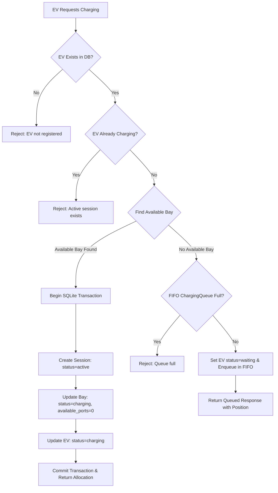
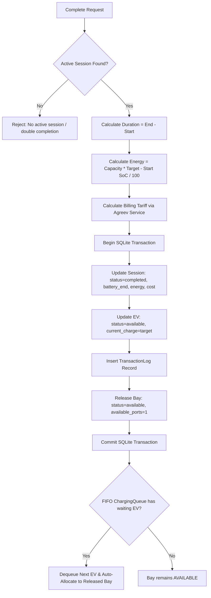

# Smart EV Hub — Charging Stations & Sessions Module

**Module Owner:** Mritunjay Thakur  
**Student ID:** 2519425  
**Section:** ML-5  
**Primary Directory:** `backend/mritunjay_thakur/`  
**Frontend Pages:** `src/pages/ChargingStations.tsx`, `src/pages/StationDetails.tsx`  
**Dedicated Test Suite:** `test_mritunjay_thakur` (Unit Tests) & `node scripts/test-e2e-scenarios.js` (E2E Integration)  

---

## 1. Module Overview & Architectural Responsibilities

The **Charging Stations & Charging Sessions Module** orchestrates the physical charging hardware, bay availability, session telemetry, queuing, and billing workflows within the Smart EV Hub system.

### Core Architectural Responsibilities:
1. **Hardware Bay Lifecycle Management:** Modeling and tracking charging bays across four operational states (`available`, `charging`, `maintenance`, `offline`).
2. **Session Telemetry & Persistence:** Atomic creation, tracking, and closure of EV charging sessions in SQLite with real-time SoC telemetry, energy consumption calculations, and timestamp recording.
3. **Smart Bay Allocation:** Real-time matching of incoming EVs with compatible, available charging hardware.
4. **FIFO Charging Queue Integration:** Seamless handoff to Abhishek Ghansala's educational circular FIFO `ChargingQueue` when all bays are occupied.
5. **Session Release & Automatic Queue Dispatch:** Atomic session closure, tariff calculation via Agreev Singh's `Transaction::calculateTariff`, hardware release, and instant auto-dispatch of the next waiting EV from the FIFO queue.
6. **Hardware Deployment & Configuration:** Dynamic station creation (`POST /api/stations`) with validation of power rating, connector types, and port capacity.
7. **Educational Compliance (2nd-Year DSA PBL):** Implementation using simple fixed-size C++ arrays within `StationService` (no `std::vector`), respecting data structures and algorithms coursework requirements.

---

## 2. Directory & File Structure

```
backend/mritunjay_thakur/
├── README.md                           # Comprehensive module documentation
├── models/
│   ├── charging_station.h              # ChargingStation domain model (states, ports, power)
│   └── charging_session.h              # ChargingSession model (telemetry, duration, tariff)
├── services/
│   ├── station_service.h               # StationService declaration (fixed array storage)
│   └── station_service.cpp             # Allocation, state transitions, SQLite queries, queue rehydration
├── api/
│   ├── station_routes.h                # Station REST endpoint declarations
│   ├── station_routes.cpp              # GET/POST /api/stations, PUT status handlers
│   ├── charging_routes.h               # Charging session endpoint declarations
│   └── charging_routes.cpp             # POST /api/charging/request, complete, sessions
└── tests/
    └── test_mritunjay.cpp              # Dedicated 18-scenario comprehensive test suite
```

Frontend Files:
- `src/pages/ChargingStations.tsx` — Real-time charging bays dashboard (6 KPI stat cards, filters, dialogs).
- `src/pages/StationDetails.tsx` — Hardware telemetry, session progress, control actions, and station history.
- `src/services/api.ts` — API client bindings (`getStations`, `getStationById`, `createStation`, `updateStationStatus`, `requestCharging`, `completeCharging`).
- `src/context/AppContext.tsx` — React state context and optimistic updates.

---

## 3. Database Tables & Fields

The module interfaces with SQLite (`evhub.db`) using the canonical schema defined in `backend/database/schema.sql`:

### A. `ChargingStation` Table
| Column | Type | Constraints | Description |
|---|---|---|---|
| `id` | TEXT | PRIMARY KEY | Unique hardware ID (e.g., `CS-1`, `CS-E2E-1`) |
| `name` | TEXT | NOT NULL | Friendly display name (e.g., `DC Fast Charger 1`) |
| `power` | REAL | NOT NULL DEFAULT 50.0 | Power rating in kW (25 kW – 150 kW) |
| `connector_type` | TEXT | CHECK(connector_type IN ('Type 2', 'CCS2', 'CHAdeMO', 'GB/T')) | Standard connector type |
| `status` | TEXT | CHECK(status IN ('available', 'charging', 'maintenance', 'offline')) | Operational hardware state |
| `current_vehicle_id`| TEXT | FOREIGN KEY -> EV(id) | Occupying EV ID or NULL |
| `session_start` | DATETIME | DEFAULT NULL | Timestamp when active session commenced |
| `location` | TEXT | NOT NULL DEFAULT 'Bay 1' | Terminal location tag |
| `total_ports` | INTEGER | DEFAULT 1 | Physical connector count |
| `available_ports` | INTEGER | DEFAULT 1 | Open port count (0 when charging/offline/maint) |

### B. `ChargingSession` Table
| Column | Type | Constraints | Description |
|---|---|---|---|
| `id` | TEXT | PRIMARY KEY | Unique session ID (e.g., `SES-1001`) |
| `vehicle_id` | TEXT | FOREIGN KEY -> EV(id) | Connected EV ID |
| `ev_model` | TEXT | NOT NULL | Vehicle model snapshot |
| `station_id` | TEXT | FOREIGN KEY -> ChargingStation(id) | Assigned bay ID |
| `start_time` | DATETIME | DEFAULT CURRENT_TIMESTAMP | Charging start timestamp |
| `end_time` | DATETIME | DEFAULT NULL | Charging finish timestamp |
| `battery_start` | REAL | NOT NULL | Initial Battery SoC % |
| `battery_end` | REAL | DEFAULT NULL | Final Battery SoC % (set on completion) |
| `target_charge` | REAL | NOT NULL DEFAULT 100.0 | Requested cutoff SoC % |
| `energy_consumed` | REAL | DEFAULT 0.0 | Total kWh delivered to battery |
| `estimated_cost` | REAL | DEFAULT 0.0 | Calculated bill amount in INR |
| `status` | TEXT | CHECK(status IN ('active', 'completed')) | Session progress state |

### C. `TransactionLog` Table (Integration with Agreev Singh)
On session completion, an atomic record is inserted with `type = 'charging'`, storing energy delivered, duration in minutes, and tariff amount, and pushed onto Abhishek Ghansala's LIFO stack.

---

## 4. REST API Endpoints Specification

### 1. List All Stations
- **Method / Path:** `GET /api/stations`
- **Response:** `200 OK`
```json
[
  {
    "id": "CS-1",
    "name": "Standard Bay 1",
    "power": 25.0,
    "connectorType": "CCS2",
    "status": "charging",
    "currentEV": "EV-101",
    "location": "Bay A-1",
    "totalPorts": 1,
    "availablePorts": 0,
    "sessionStart": "2026-11-17 12:00:00"
  }
]
```

### 2. Get Station Details
- **Method / Path:** `GET /api/stations/:id`
- **Response (200 OK):**
```json
{
  "id": "CS-2",
  "name": "Fast Bay 2",
  "power": 29.0,
  "connectorType": "CCS2",
  "status": "available",
  "currentEV": "",
  "location": "Bay A-2",
  "totalPorts": 1,
  "availablePorts": 1,
  "sessionStart": null
}
```
- **Error (404 Not Found):** `{"error": "Station not found"}`

### 3. Deploy New Station
- **Method / Path:** `POST /api/stations`
- **Request Body:**
```json
{
  "id": "CS-5",
  "name": "Highway Supercharger 5",
  "power": 120.0,
  "connectorType": "CCS2",
  "location": "Terminal C-1",
  "totalPorts": 1
}
```
- **Response (201 Created):**
```json
{
  "success": true,
  "message": "Station created successfully",
  "station": {
    "id": "CS-5",
    "name": "Highway Supercharger 5",
    "power": 120.0,
    "connectorType": "CCS2",
    "status": "available",
    "location": "Terminal C-1",
    "totalPorts": 1,
    "availablePorts": 1
  }
}
```
- **Errors:** `400 Bad Request` (missing/invalid fields), `409 Conflict` (duplicate station ID).

### 4. Update Station Operational Status
- **Method / Path:** `PUT /api/stations/:id/status`
- **Request Body:**
```json
{
  "status": "maintenance"
}
```
- **Response (200 OK):**
```json
{
  "success": true,
  "message": "Station status updated to maintenance",
  "status": "maintenance",
  "station": {
    "id": "CS-2",
    "status": "maintenance"
  }
}
```
- **Errors:**
  - `400 Bad Request` if attempting to set status to `charging` manually without allocation.
  - `400 Bad Request` if attempting to set an actively charging bay to `available`, `maintenance`, or `offline` before session completion.
  - `404 Not Found` if station does not exist.

### 5. Request EV Charging Allocation
- **Method / Path:** `POST /api/charging/request`
- **Request Body:**
```json
{
  "evId": "EV-103",
  "targetCharge": 85.0
}
```
- **Response (200 OK - Immediate Allocation):**
```json
{
  "success": true,
  "assigned": true,
  "stationId": "CS-2",
  "sessionId": "SES-1002-8641",
  "targetCharge": 85.0,
  "estimatedCost": 156.40,
  "message": "Assigned to Station CS-2"
}
```
- **Response (200 OK - All Stations Occupied, Queued in FIFO):**
```json
{
  "success": true,
  "assigned": false,
  "queued": true,
  "queuePosition": 1,
  "queueSize": 1,
  "frontIndex": 0,
  "rearIndex": 0,
  "message": "All stations currently busy. Added vehicle EV-104 to Charging Queue (Position: 1)."
}
```
- **Errors:**
  - `400 Bad Request` if EV does not exist.
  - `400 Bad Request` if EV is already actively charging or already in the charging queue.

### 6. Complete Charging Session
- **Method / Path:** `POST /api/charging/complete`
- **Request Body:** (Accepts either `stationId` or `sessionId`)
```json
{
  "sessionId": "SES-1002-8641"
}
```
- **Response (200 OK):**
```json
{
  "success": true,
  "message": "Station CS-2 session completed.",
  "sessionId": "SES-1002-8641",
  "stationId": "CS-2",
  "evId": "EV-103",
  "transactionId": "TXN-6001-8641",
  "amount": 156.40,
  "energyDelivered": 8.68,
  "duration": 18,
  "finalCharge": 85.0,
  "dispatched": true,
  "dispatchedEvId": "EV-104",
  "dispatchedSessionId": "SES-1003-9122"
}
```
- **Errors:** `400 Bad Request` if session is already completed (double-completion safeguard) or does not exist.

### 7. Retrieve Sessions
- **`GET /api/sessions`** — List all sessions (supports optional query `?status=active` or `?status=completed`).
- **`GET /api/sessions/active`** — Direct convenience endpoint for currently running sessions.

---

## 5. Station State Transition Rules

The hardware status state machine strictly enforces 4 valid operational states:

```
                  ┌──────────────┐
     ┌───────────►│  AVAILABLE   │◄──────────────┐
     │            └──────┬───────┘               │
     │                   │                       │
     │  Session End /    │ Auto-Allocation       │  Service Complete /
     │  Release          ▼                       │  Online Recovery
     │            ┌──────────────┐               │
     │            │   CHARGING   │               │
     │            └──────────────┘               │
     │                                           │
     │   Manual Service            Manual Power  │
     ├──────────────────────────┐  Cutoff        │
     ▼                          ▼                │
┌──────────────┐         ┌──────────────┐        │
│ MAINTENANCE  │         │   OFFLINE    │────────┘
└──────┬───────┘         └──────┬───────┘
       │                        ▲
       └────────────────────────┘
```

### State Machine Transition Table:
| From Status | Target Status | Allowed? | Condition / Rule |
|---|---|---|---|
| `available` | `charging` | **NO (Manual)** | Direct manual status update rejected; only allowed through `/api/charging/request` allocation workflow. |
| `available` | `maintenance` | **YES** | Hardware bay taken down for maintenance; ports set to 0. |
| `available` | `offline` | **YES** | Station powered down; ports set to 0. |
| `charging` | `available` | **NO (Manual)** | Cannot force-clear bay while charging; session must be completed first. |
| `charging` | `maintenance` | **NO** | Active charging bay cannot be put into maintenance until session is completed. |
| `charging` | `offline` | **NO** | Active charging bay cannot be powered off until session is completed. |
| `maintenance`| `available` | **YES** | Maintenance complete; ports restored to totalPorts. |
| `maintenance`| `offline` | **YES** | Maintenance station powered off. |
| `offline` | `available` | **YES** | Reconnected and operational; ports restored to totalPorts. |
| `offline` | `maintenance` | **YES** | Offline station scheduled for repair. |

---

## 6. Charging Allocation & Completion Algorithms

### Allocation Workflow (`createChargingSession`):


### Completion Workflow (`completeChargingSession`):


---

## 7. Tariff & Billing Formula

Billing is calculated through integration with Agreev Singh's `Transaction::calculateTariff`:

$$\text{Energy Delieved (kWh)} = \text{Battery Capacity} \times \frac{\text{Target SoC} - \text{Start SoC}}{100}$$

$$\text{Total Bill (₹)} = \text{Base Fee} + (\text{Energy Delivered} \times \text{Tariff Rate})$$

Where:
- **Base Fee:** ₹50.00
- **Fast DC Charger (CCS2 / CHAdeMO / GB/T):** ₹18.00 per kWh
- **AC Charger (Type 2):** ₹12.00 per kWh

*Example:* A 50.3 kWh EV charged from 18% to 60% at a CCS2 bay:
- Energy = $50.3 \times \frac{60 - 18}{100} = 21.126\text{ kWh}$
- Bill = $50 + (21.126 \times 18) = \text{₹}430.27$

---

## 8. Build & Verification Instructions

### Prerequisites:
- MinGW-w64 GCC (`C:\mingw64\bin\g++.exe`)
- CMake 4.4+ (`C:\cmake\bin\cmake.exe`)
- Node.js LTS 24.20+ (`npm.cmd`)

### 1. Build C++ Backend & Test Suites:
```powershell
$env:Path = "C:\mingw64\bin;C:\cmake\bin;" + $env:Path
cd "backend"
if (!(Test-Path build)) { mkdir build }
cd build
cmake -G "MinGW Makefiles" ..
cmake --build .
```

### 2. Run Mritunjay Thakur Dedicated Test Suite:
```powershell
.\test_mritunjay_thakur.exe
```
Output verifies all 18 test scenarios:
- Test 1: Station Creation
- Test 2: Station Retrieval
- Test 3: Valid Station Status Update
- Test 4: Invalid Status Transition Rejection
- Test 5: Charging Allocation
- Test 6: Allocation When All Stations Occupied
- Test 7: FIFO Queue Integration
- Test 8: Charging Session Completion
- Test 9: Energy Consumption Calculation
- Test 10: Billing Tariff Calculation
- Test 11: Station Release
- Test 12: Duplicate Active Session Prevention
- Test 13: Invalid EV ID Rejection
- Test 14: Invalid Station ID Rejection
- Test 15: Double Session Completion Rejection
- Test 16: SQLite Persistence Across Restart
- Test 17: Concurrent Allocation Safety
- Test 18: Maintenance/Offline Station Rejection

### 3. Run Automated End-to-End Scenarios:
```powershell
node scripts/test-e2e-scenarios.js
```
Verifies live HTTP server, CORS, session transitions, billing, and restart persistence.

### 4. Build React/TypeScript Frontend:
```powershell
npm.cmd run build
```
Executes `tsc --noEmit && vite build`, creating the optimized production bundle in `dist/`.

---

## 9. Verification Summary

| Suite / Check | Command | Result |
|---|---|---|
| Mritunjay Thakur Unit Tests | `.\test_mritunjay_thakur.exe` | **18 / 18 PASSED (100%)** |
| End-to-End Scenario Suite | `node scripts/test-e2e-scenarios.js` | **16 / 16 PASSED (100%)** |
| Frontend Production Build | `npm.cmd run build` | **BUILT IN 25.95s (0 Errors)** |
| Teammate Modules Regression | `test_aditya`, `test_priyanshu`, `test_amit`, `test_abhishek`, `test_agreev` | **ALL PASSED (100%)** |
